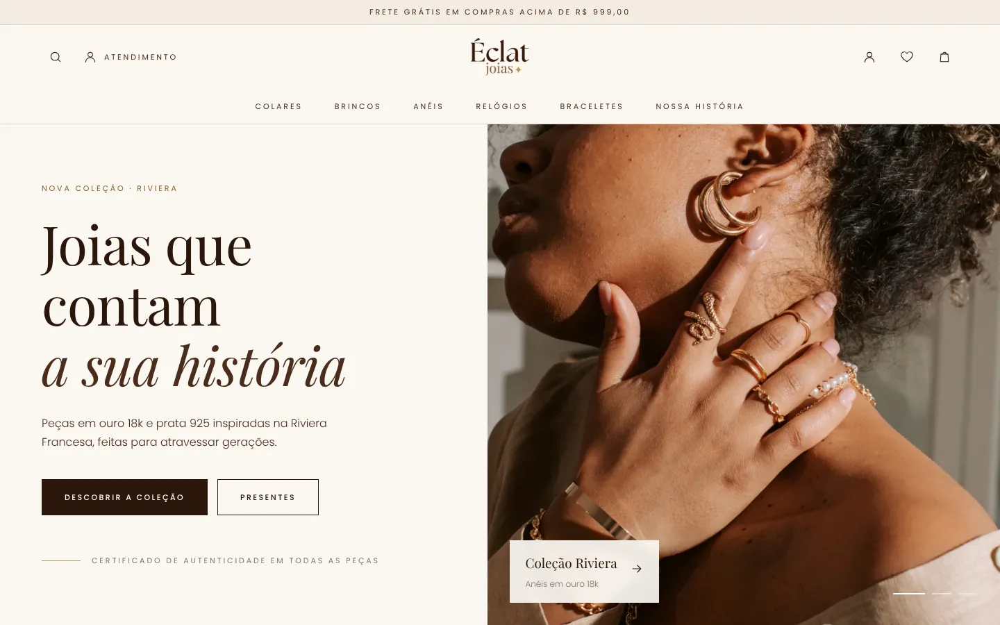
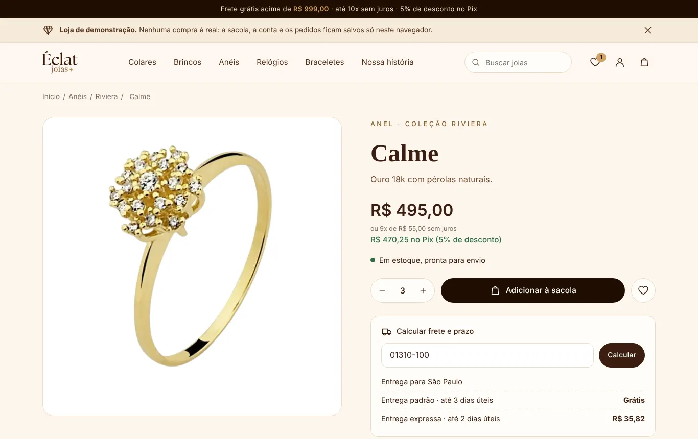
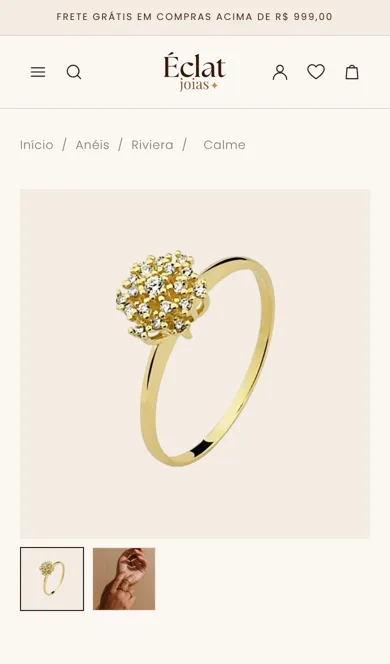
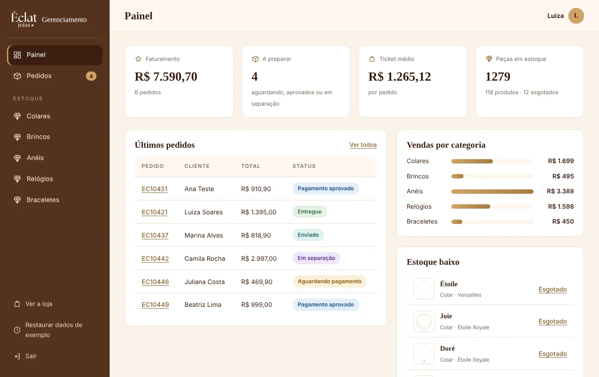

<h1 align="center">Éclat Joias</h1>

<h3 align="center">
  <a href="https://biabruna19.github.io/Eclat/">Ver a loja → biabruna19.github.io/Eclat</a>
</h3>

<p align="center">
  
</p>

## Sobre

E-commerce de uma joalheria fictícia, com colares, brincos, anéis, relógios e braceletes em prata 925 e ouro 18k. Cada categoria tem duas coleções com nomes franceses, inspiradas na Riviera.

A loja funciona do começo ao fim: dá para escolher as joias, montar a sacola, criar uma conta, finalizar a compra e acompanhar o pedido. Há também um painel administrativo para cuidar do estoque e dos pedidos.

## Visual

O layout segue o estilo das joalherias de luxo: logo no centro, menu em letras pequenas com um menu grande que mostra as coleções, muito espaço vazio, botões retos e traços finos em dourado. As fotos dos produtos foram padronizadas (todas as joias centralizadas e do mesmo tamanho), e ao passar o mouse aparece uma segunda foto com a joia em uso.

## O que dá para fazer

**Na loja**
- Navegar pelas coleções, filtrar por ouro ou prata, ordenar por preço e esconder o que está esgotado.
- Montar um conjunto (colar, brinco e anel da mesma linha) com 10% de desconto na página inicial.
- Buscar joias pelo nome, material ou pedra. A busca funciona com ou sem acento.
- Ver cada joia na sua página, com galeria (a peça e a foto com modelo), zoom, parcelamento, preço no Pix, aviso de "últimas unidades" e cálculo de frete pelo CEP.
- Salvar favoritos e montar a sacola. A sacola lateral abre a cada joia adicionada e mostra quanto falta para o frete grátis.
- Usar cupons de desconto (na demonstração: `ECLAT10`, `BEMVINDA15` e `FRETEGRATIS`).
- Finalizar a compra:
  - o endereço é preenchido pelo CEP;
  - escolha entre entrega padrão ou expressa;
  - pagamento por Pix, cartão (com validação do número) ou boleto.
- Criar conta, editar os dados e acompanhar os pedidos com a linha do tempo de cada um.

**No painel administrativo**
- Resumo de vendas, pedidos a preparar, vendas por categoria e estoque baixo.
- Estoque de cada categoria: ajustar a quantidade, editar, adicionar produto com foto e remover.
- Pedidos: buscar, filtrar por status, ver os detalhes e mudar o status. A mudança aparece na hora em "Minha conta" da cliente.

<p align="center">
  
  
</p>

<p align="center">
  
</p>

## Como testar

- **Cliente:** entre com `luiza@eclat.com` e a senha `123456`, ou crie uma conta nova.
- **Administrador:** clique em "Acesso administrador", no rodapé, e entre com `admin@eclat.com` e a senha `eclat2025`.
- No painel, "Restaurar dados de exemplo" volta tudo ao estado inicial.

A loja roda em modo demonstração: nenhuma compra é real, e a sacola, as contas, os pedidos e o estoque ficam salvos só no navegador de quem está testando.

## Tecnologias

HTML, CSS e JavaScript, sem frameworks. Os dados ficam no `localStorage`, e o endereço vem da API pública do ViaCEP.

A primeira versão foi feita com PHP e MySQL. Por isso ela não rodava no GitHub Pages, e o banco de dados nem estava no repositório: o estoque aparecia vazio e o carrinho dependia da sessão do PHP. Nesta versão a loja foi refeita para funcionar só no navegador, mantendo a identidade visual (as cores, as fontes Playfair Display e Poppins e a logo).

Também mudou:
- os produtos estavam repetidos em 11 arquivos e agora ficam num catálogo só;
- as fotos dos braceletes não apareciam por causa de uma diferença entre maiúscula e minúscula no nome da pasta;
- as imagens foram convertidas para WebP: de 58 MB para menos de 4 MB.

## Rodando no computador

```bash
git clone https://github.com/biabruna19/Eclat.git
cd Eclat
python3 -m http.server 8000
```

Depois é só abrir `http://localhost:8000` no navegador.

## Organização

```
index.html           início
colecao.html         coleções, categorias e busca
produto.html         página de cada joia
sacola.html          sacola, cupom e frete
checkout.html        endereço, entrega, pagamento e confirmação
entrar.html          login e cadastro
conta.html           pedidos e dados da cliente
favoritos.html       favoritos
sobre.html           nossa história
admin/               painel, estoque e pedidos
js/catalogo.js       os 118 produtos e as 10 coleções
js/loja.js           sacola, favoritos, contas, pedidos, topo e rodapé
js/paginas/          o script de cada página
css/                 estilos da loja e do painel
imagens/             fotos em WebP
```

## Desenvolvido por

**Beatriz Oliveira**<br>
[GitHub](https://github.com/biabruna19) · [LinkedIn](https://www.linkedin.com/in/beatriz-oliveira-759867294/) · [E-mail](mailto:biabruna.1901@gmail.com)

---

A Éclat Joias é uma marca fictícia, criada para este projeto de portfólio.
